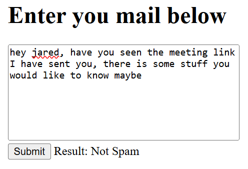

# Spam Mail Classifier

A small web app that tells you whether an email is **spam**, **not spam**, or **unsure**. Paste the text of an email into the page and get a verdict from two machine learning models.



## How it works

Two models classify each email independently:

- **Naive Bayes**
- **Logistic Regression**

If both models agree, you get that result (spam or not spam). If they disagree, the app returns **unsure** instead of guessing. This makes the output more cautious, since a disagreement between two different models is a useful signal that the email is borderline.

## Features

- Paste any email text and get an instant classification
- Three possible results: spam, not spam, unsure
- Two models combined for a more cautious verdict
- Simple web frontend with a lightweight backend server

## Tech stack

- **Models:** Python, scikit-learn, NLTK
- **Server:** Flask
- **Frontend:** HTML, CSS, vanilla JavaScript
- **Dataset:** Spam email Dataset: https://www.kaggle.com/datasets/jackksoncsie/spam-email-dataset

## Getting started

### Prerequisites

- [Python 3.x]

### Installation

```bash
git clone https://github.com/denizbekirDB2/spam-email-classifier.git
cd spam-email-classifier
pip install -r requirements.txt
```

### Run the app

```bash
python server.py
```

Then open http://127.0.0.1:5000 in your browser.

## Usage

1. Paste the text of an email into the text area.
2. Click **Submit**.
3. Read the result:

| Result | Meaning |
|--------|---------|
| Spam | Both models classify the email as spam |
| Not spam | Both models classify the email as not spam |
| Unsure | The models disagree |

## Model performance

| Model               | Class          | Precision | Recall | F1-score | Support |
|---------------------|----------------|-----------|--------|----------|---------|
| Logistic Regression | Not spam (0)   | 0.97      | 1.00   | 0.98     | 885     |
| Logistic Regression | Spam (1)       | 0.99      | 0.90   | 0.95     | 261     |
| Naive Bayes         | Not spam (0)   | 0.98      | 1.00   | 0.99     | 885     |
| Naive Bayes         | Spam (1)       | 1.00      | 0.95   | 0.97     | 261     |

Both models perform well on the test set. Naive Bayes is slightly ahead with 99% accuracy, compared to 98% for Logistic Regression. Precision for spam is very high (0.99 and 1.00), so legitimate emails are almost never flagged as spam. Recall for spam is lower (0.90 and 0.95), which means some spam emails slip through as "not spam". Since the two models make different mistakes, returning "unsure" when they disagree flags borderline emails instead of silently misclassifying them.
## Limitations

- Uses only the email text, not headers, links, or attachments
- Not deployed; runs locally only

## Future improvements

- Deploy the app online
- Support uploading `.eml` files

## License

[MIT / etc.]